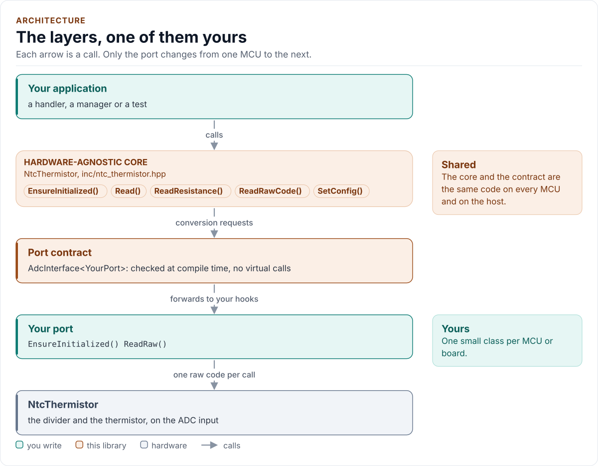
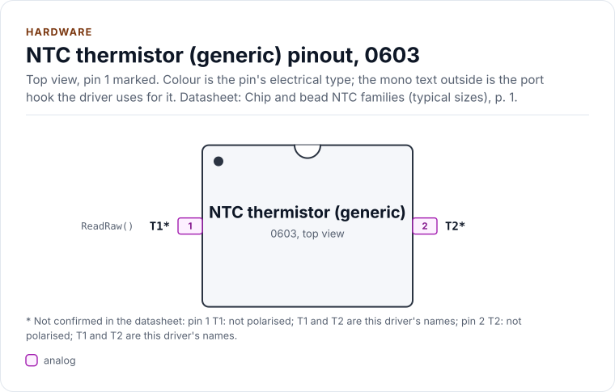
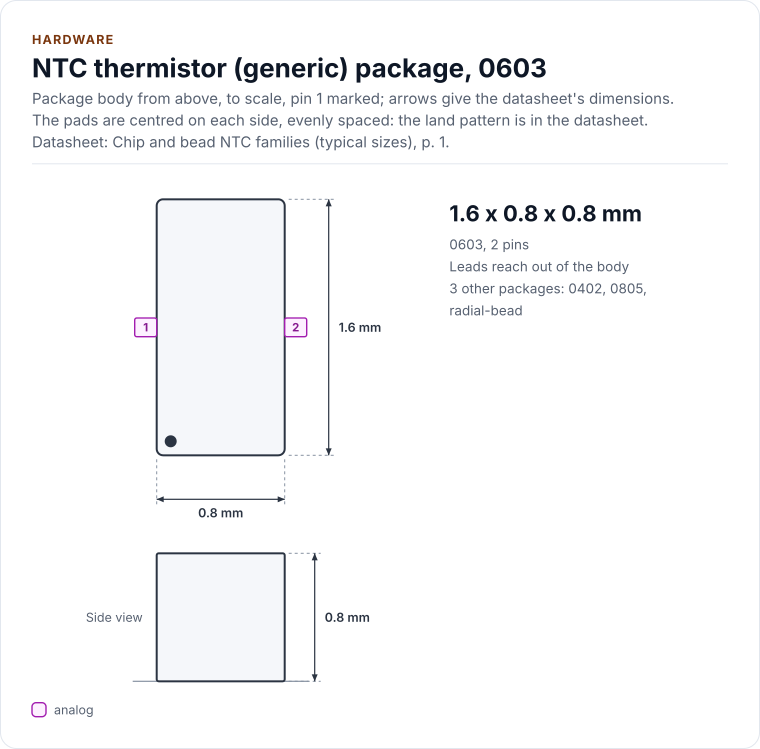
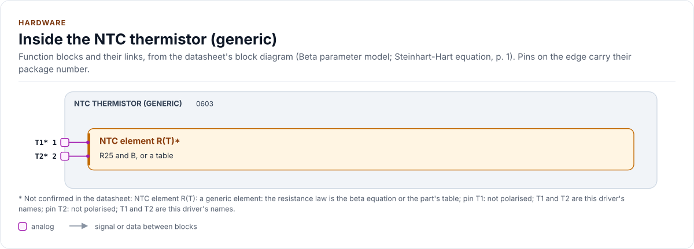

# NTC thermistor driver

C++20 driver for NTC thermistors, generic for any part, read through a resistor divider into an ADC port, with integer
arithmetic only.

[](https://github.com/kokeb-labs-drivers/driver-ntc-thermistor/actions/workflows/ci.yml)
[](LICENSE)
[](docs/installation.md#requirements)

**Documentation: [`docs/`](docs/index.md)**, with the API reference built by Doxygen ([how](docs/api-reference.md)).
The site at <https://kokeb-labs-drivers.github.io/driver-ntc-thermistor/> opens when the repository is public.

A thermistor is a resistor whose value falls as it heats. This driver reads the node of a divider (the thermistor and a
series resistor) through your MCU's ADC, finds the thermistor's resistance, and looks the temperature up on the curve
you declare: a table of resistance and temperature rows, Steinhart-Hart coefficients, or R25 and B for the beta
equation. The part is **data**, so any NTC works with no change of code, and `tools/ntc_table.py` makes a table from
any description or a vendor's list. Open and short circuits, a part outside its rated window and noisy samples
are errors with their own names, and every reading carries an uncertainty bound. You give it a small class that reads
one raw ADC count; it does the rest, with no floating point and no library calls.

<!-- figure: driver-layers -->
<picture>
  <source media="(prefers-color-scheme: dark)" srcset="docs/diagrams/driver-layers.dark.svg">
  
</picture>
<!-- /figure -->

## At a glance

<!-- figure: chip-pinout -->
<picture>
  <source media="(prefers-color-scheme: dark)" srcset="docs/diagrams/chip-pinout.dark.svg">
  
</picture>
<!-- /figure -->

<!-- figure: chip-outline -->
<picture>
  <source media="(prefers-color-scheme: dark)" srcset="docs/diagrams/chip-outline.dark.svg">
  
</picture>
<!-- /figure -->

<!-- figure: chip-blocks -->
<picture>
  <source media="(prefers-color-scheme: dark)" srcset="docs/diagrams/chip-blocks.dark.svg">
  
</picture>
<!-- /figure -->

<!-- generated: chip-card -->
| | | Datasheet |
| --- | --- | --- |
| **Package** | 0603 | Chip and bead NTC families (typical sizes), p. 1 |
| **Pins** | 2 | Chip and bead NTC families (typical sizes), p. 1 |
| **Body size** | 1.6 x 0.8 x 0.8 mm | Chip and bead NTC families (typical sizes), p. 1 |
| **Variants** | `chip0402`, `chip0805`, `bead` (below) | Chip and bead NTC families (typical sizes), p. 1 |

Also sold as:

| Variant | Package | Pins | Size | Ordering | Note | Datasheet |
| --- | --- | --- | --- | --- | --- | --- |
| `chip0402` | 0402 | 2 | about 1.0 x 0.5 mm (family nominal) | - | typical, not a datasheet claim | Chip and bead NTC families (typical sizes), p. 1 |
| `chip0805` | 0805 | 2 | about 2.0 x 1.25 mm (family nominal) | - | typical, not a datasheet claim | Chip and bead NTC families (typical sizes), p. 1 |
| `bead` | radial-bead | 2 | glass bead or epoxy-coated disc on two leads | - | typical, not a datasheet claim | Chip and bead NTC families (typical sizes), p. 1 |

From [`docs/hardware.yml`](docs/hardware.yml); pins, circuits and the block diagram: [Hardware](docs/hardware.md).
<!-- /generated -->

| | |
| --- | --- |
| **Parts** | Any NTC thermistor: a table of 2 to 256 rows, Steinhart-Hart A, B, C, or R25 and B; a table generator. Two presets ship as examples; one is **unverified until the datasheet is supplied** |
| **Reads** | A divider into one ADC channel, low side or high side, ratiometric or with a separate reference; 8 to 24 bits |
| **Returns** | Milli-degrees Celsius, the resistance, the mean code and a bound on the declared tolerances |
| **Faults** | `OpenCircuit`, `ShortCircuit`, `BelowRange`, `AboveRange`, `Unstable`, `CodeOutOfScale` |
| **Optional** | A GPIO that powers the divider only while it is read (no self-heating between readings) |
| **Driver** | Header-only C++20; integers only; no heap, exceptions, RTTI or virtual calls; every call returns `Result<T>` |
| **Runs on** | Any MCU with an ADC and a C++20 compiler; examples for the host and ESP32 (ESP-IDF) |
| **Status** | 0.1.0, **not verified on hardware**: host-tested against an independent model and fuzzed ([limitations](docs/limitations.md)) |

## Datasheet

<!-- generated: datasheet-card -->
| Document | Revision | Get it |
| --- | --- | --- |
| Reference: Beta equation, Steinhart-Hart equation and the voltage divider (Public references n/a) | n/a, n/a | [vendor page](https://en.wikipedia.org/wiki/Steinhart%E2%80%93Hart_equation) |
| Datasheet: NTCG163JF103FT1S chip NTC thermistor (worked example; unverified until the datasheet is supplied) (TDK unverified) | unverified, unverified | [vendor page](https://product.tdk.com/en/search/sensor/ntc/chip-ntc-thermistor/info?part_no=NTCG163JF103FT1S) |

Written against these revisions; the SHA-256 of each file is in [`docs/datasheets.yml`](docs/datasheets.yml). Where each
part of the driver is in the datasheet: [Datasheet map](docs/datasheet.md).
<!-- /generated -->

The driver is generic and follows the beta and Steinhart-Hart equations; the one vendor datasheet is the worked
example's and was not available, so it is **unverified until the datasheet is supplied** ([Datasheet
map](docs/datasheet.md)).

## Try it on your PC

No hardware needed: [`examples/host`](examples/host/README.md) runs the driver against a simulated divider and four
parts. You need git, CMake 3.16+ and a C++20 compiler (GCC 10+, Clang 13+ or MSVC 2022).

1. Get the source:

   ```bash
   git clone https://github.com/kokeb-labs-drivers/driver-ntc-thermistor.git && cd driver-ntc-thermistor
   ```

2. Build and run the example:

   ```bash
   cmake -S examples/host -B build-example
   cmake --build build-example
   ./build-example/ntc_thermistor_host_example
   ```

3. You should see each part read over a range of temperatures, then each fault named; the last line is
   `all readings within their bounds`, and the exit code is 0.

To run the whole test suite instead: `cmake -S . -B build -DNTC_THERMISTOR_BUILD_TESTS=ON && cmake --build build &&
ctest --test-dir build`.

## In 30 seconds

**1. Wire it** ([Hardware](docs/hardware.md) has the divider, the series resistor and the ADC input):

| MCU | Divider | Notes |
| --- | --- | --- |
| ADC input | Node between the series resistor and the thermistor | Thermistor to ground (low side) |
| 3.3 V | Series resistor, 10 k as a start | The same rail as the ADC reference |
| GND | Thermistor | Same ground as the ADC |

**2. Write the port**: a class with `EnsureInitialized()` (bring the ADC up) and `ReadRaw()` (one raw conversion), about
15 lines on most SDKs; `DelayUs()` and `SetBias()` are optional. [Porting](docs/porting.md) has the contract.

**3. Read the temperature:**

<!-- generated: quickstart-code -->
```cpp
#include "ntc_thermistor.hpp"
#include "ntc_thermistor_presets.hpp"

// A 10 kOhm / B 3950 thermistor low-side in a 10 kOhm divider on a 12-bit ADC,
// valid from -40 to +125 degC.
constexpr ntc_thermistor::Config kConfig{.curve = ntc_thermistor::presets::kGeneric10kB3950,
                                         .min_temperature_mc = -40'000,
                                         .max_temperature_mc = 125'000};

int read_temperature_mc(MyPort& port, int32_t& milli_celsius) {
  ntc_thermistor::NtcThermistor<MyPort> sensor(port, kConfig); // no I/O yet

  if (auto r = sensor.EnsureInitialized(); !r) { // 1. check the config, bring the ADC up
    return static_cast<int>(r.error);            //    InvalidArgument or Bus
  }
  const auto t = sensor.Read(); // 2. sample, divider to ohms, curve to temperature
  if (!t) {
    return static_cast<int>(t.error); //    OpenCircuit, ShortCircuit, BelowRange, ...
  }
  milli_celsius = t.value.temperature_mc; // 3. milli-degrees Celsius;
                                          // t.value.uncertainty_mc bounds it
  return 0;
}
```
<!-- /generated -->

There is no default part: you name one. A beta curve needs the range the part is rated for, because the equation
extrapolates; a table carries its own. `EnsureInitialized()` is the only call that starts anything; every other call
returns `Error::NotInitialized` until it has succeeded.

## What it does

- Reads the divider node through your MCU's ADC, averaging several conversions and refusing samples that disagree.
- Finds the resistance and the temperature with integers only: a table interpolated linearly in ln R, or the beta
  equation in fixed point.
- Names the faults: a cut wire, a short, a part outside its window, an ADC that returns more bits than declared.
- Bounds every reading from the tolerances you declare and one converter step.
- Returns `Result<T>` with an `Error` from every call: no exceptions, no heap, no RTTI, no virtual calls.

## Add it to your project

Pick the row that matches your build; each is a few steps, and [Installation](docs/installation.md) has the details.

| Your build | Steps below |
| --- | --- |
| Plain CMake: STM32 (CubeMX), RP2040 (Pico SDK), nRF Connect, a host app | [A](#a-cmake-any-mcu) |
| ESP-IDF | [B](#b-esp-idf) |
| An SDK or OS image that installs libraries | [C](#c-installed-package) |

### A. CMake, any MCU

1. Add the driver as a submodule, pinned to the version you chose:

   ```bash
   git submodule add https://github.com/kokeb-labs-drivers/driver-ntc-thermistor.git external/driver-ntc-thermistor
   ```

2. In your `CMakeLists.txt`, after `project()`:

   ```cmake
   add_subdirectory(external/driver-ntc-thermistor)
   target_link_libraries(my_app PRIVATE ntc_thermistor::ntc_thermistor)   # brings the headers and C++20
   ```

3. In your code, `#include "ntc_thermistor.hpp"`, write the port ([Porting](docs/porting.md)) and build. A first build
   that compiles the quickstart above is the check that the driver is wired in.

### B. ESP-IDF

1. Add the driver under your project's `components/`; ESP-IDF finds it there and names it after the folder:

   ```bash
   git submodule add https://github.com/kokeb-labs-drivers/driver-ntc-thermistor.git components/ntc_thermistor
   ```

2. In `main/CMakeLists.txt`, list it: `idf_component_register(SRCS "main.cpp" REQUIRES ntc_thermistor)`.
3. `idf.py menuconfig` now has a **NTC thermistor** menu (ADC channel, the divider, the curve, the window),
   and `idf.py build` builds the driver with your app. [`examples/esp32`](examples/esp32) is a complete
   project with a port for the board.

### C. Installed package

1. Install it once into a prefix:

   ```bash
   cmake -S external/driver-ntc-thermistor -B build-ntc_thermistor &&
     cmake --install build-ntc_thermistor --prefix /opt/sdk
   ```

2. In your project, with `CMAKE_PREFIX_PATH=/opt/sdk`:

   ```cmake
   find_package(ntc_thermistor 0.1 REQUIRED)
   target_link_libraries(my_app PRIVATE ntc_thermistor::ntc_thermistor)
   ```

The target is `ntc_thermistor::ntc_thermistor` every way, so switching later changes nothing else.

## Documentation

| Page | Read it when you want to |
| --- | --- |
| [Quickstart](docs/quickstart.md) | Go from a thermistor to a temperature on your MCU |
| [Hardware](docs/hardware.md) | Choose the series resistor, handle the ADC input, understand self-heating |
| [Conversion](docs/conversion.md) | Know how a code becomes a temperature, and how accurate each curve is |
| [Presets](docs/presets.md) | Use or write a part's curve |
| [Worked example](docs/worked-example.md) | See one part end to end (unverified until its datasheet is supplied) |
| [Configuration](docs/configuration.md) | Choose the divider, the sampling and the window |
| [Porting](docs/porting.md) | Write the port class for your MCU's SDK |
| [API guide](docs/api-guide.md) | Use each call and handle each error |
| [Troubleshooting](docs/troubleshooting.md) | Find the cause of an error or a wrong reading |
| [Contract](docs/contract.md) | Know exactly what the driver promises, needs and returns |
| [Datasheet map](docs/datasheet.md) | Find the source behind each part of the driver |
| [API reference](docs/api-reference.md) | Look up a class or member (Doxygen; built by CI and locally) |

## Tests and quality

```bash
cmake -S . -B build -DNTC_THERMISTOR_BUILD_TESTS=ON && cmake --build build && ctest --test-dir build
```

The host tests run the driver against an independent floating-point model of seven different thermistors and both
divider topologies, and produce each error the driver can return. A fuzzer controls what the ADC returns and checks
the driver's promises after every call. CI also builds for Cortex-M and gates coverage, complexity, sanitizers, fuzzing,
clang-tidy, cppcheck and the handbook rules (`.kokeb/handbook.yml`). See [Testing and CI](docs/testing.md), which lists
every gate and its limit.

## License

MIT. See [LICENSE](LICENSE).
