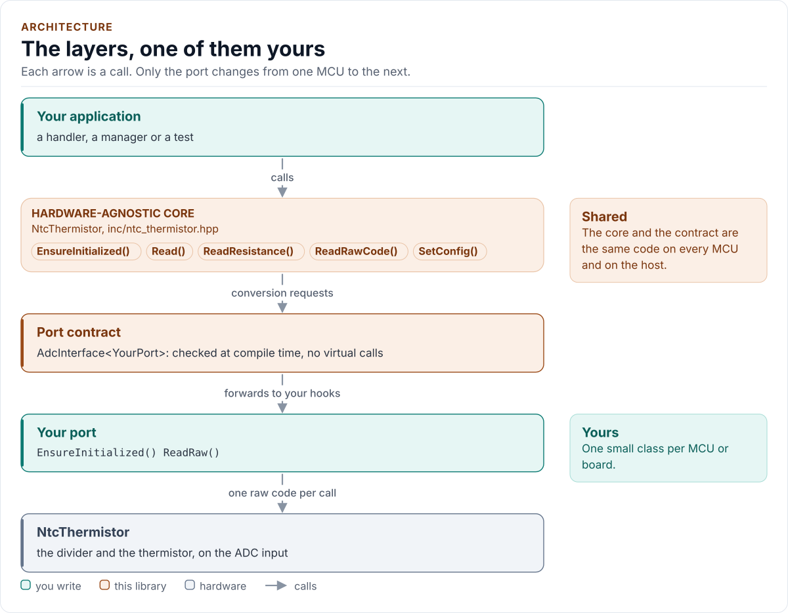
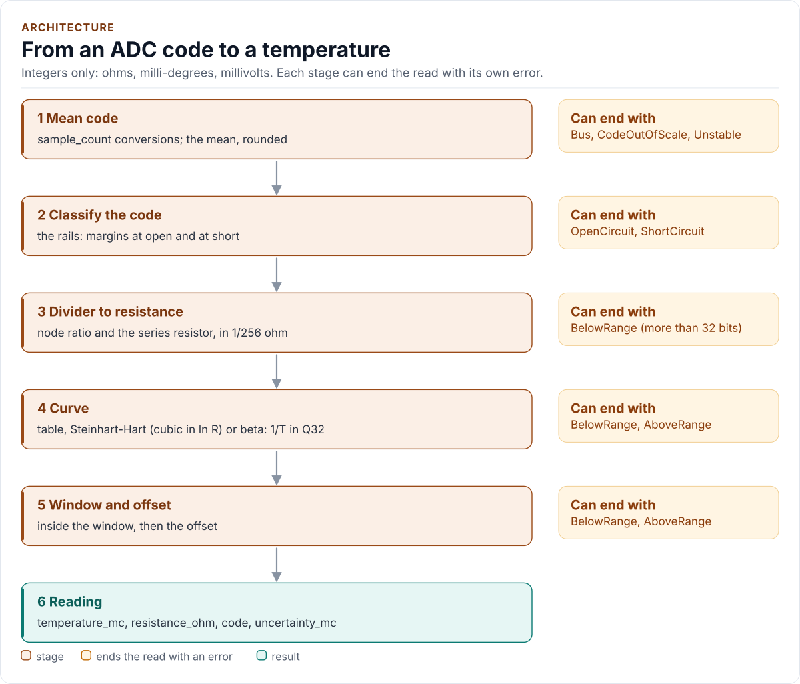

# Architecture

How the driver is built: the core, the free conversion functions, the port contract, and your port.

<!-- figure: driver-layers -->
<picture>
  <source media="(prefers-color-scheme: dark)" srcset="diagrams/driver-layers.dark.svg">
  
</picture>
<!-- /figure -->

| Layer | Files | Owns |
| --- | --- | --- |
| Core | [`inc/ntc_thermistor.hpp`](../inc/ntc_thermistor.hpp), [`src/ntc_thermistor.ipp`](../src/ntc_thermistor.ipp) | Lifecycle, sampling, the bias sequence, the port hooks |
| Conversion | [`inc/ntc_thermistor_conversion.hpp`](../inc/ntc_thermistor_conversion.hpp) | The pure maths: classification, divider, curve, bound |
| Maths | [`inc/ntc_thermistor_math.hpp`](../inc/ntc_thermistor_math.hpp) | `Ln16()`, rounded and saturating integer helpers |
| Types | [`inc/ntc_thermistor_types.hpp`](../inc/ntc_thermistor_types.hpp) | `Error`, `Result<T>`, `Curve`, `Config`, `Reading`, `Validate()` |
| Presets | [`inc/ntc_thermistor_presets.hpp`](../inc/ntc_thermistor_presets.hpp) | Two example curves, as data; included by nothing in the driver |
| Port contract | [`inc/ntc_thermistor_adc_interface.hpp`](../inc/ntc_thermistor_adc_interface.hpp) | The CRTP base and the `AdcPort` concept |
| Platform port | Your class | ADC bring-up, one raw conversion, optional delay and bias |

## The conversion is outside the class

The conversion does not depend on the port, so it lives in free functions, not in the class template: it is compiled
once per configuration, not once per port, can be used (and tested) with no port at all, and is evaluated at compile
time when the inputs are `constexpr`. `NtcThermistor<Port>::Read()` is sampling around one call to it.

<!-- figure: conversion-pipeline -->
<picture>
  <source media="(prefers-color-scheme: dark)" srcset="diagrams/conversion-pipeline.dark.svg">
  
</picture>
<!-- /figure -->

## Rules the code keeps

- **Integer only.** Resistance in ohms (1/256 inside), temperature in milli-degrees, voltage in millivolts, tolerance in
  parts per million. No `float`, no `double`, no library math.
- **A part is data.** Nothing in `inc/` or `src/` names a part; the presets are `Curve` values.
- **Bounded.** Every loop has a constant bound: the table search is at most 8 steps, `Ln16()` a fixed number of steps.
- **Port-independent code stays outside the class template.**

Next: [Contract](contract.md).
