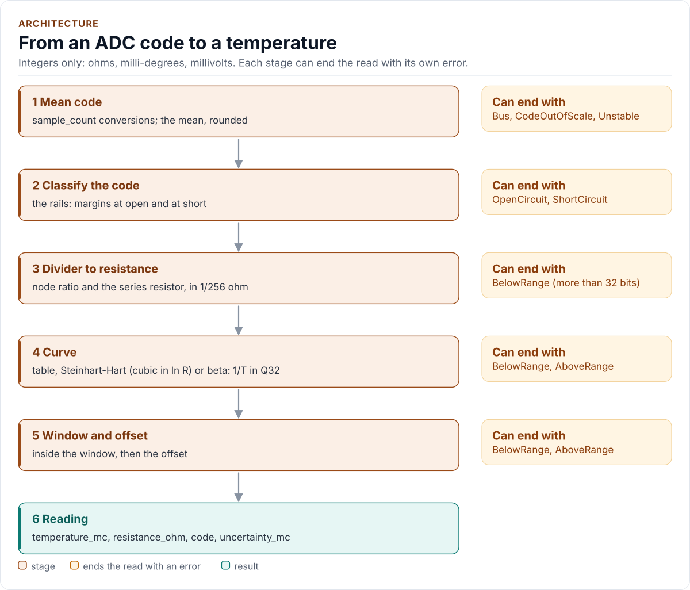

# Conversion

How a raw ADC code becomes a temperature, with integers only: the pipeline, the divider, the three ways to describe a
part, how accurate each is, and how to make a table from any description or from a vendor list.

<!-- generated: datasheet-refs -->
??? abstract "Datasheet sections this page relies on"

    From Public references n/a n/a:

    - Beta equation and the B25/85 pair: Beta model, 1/T = 1/T0 + ln(R/R0) / B, p. 1
    - Steinhart-Hart and the table tool: Steinhart-Hart, 1/T = a + b ln R + c ln(R)^3, p. 1
    - Voltage divider and the series resistor: Divider, V = V_s R_n / (R_s + R_n), p. 1

    All of them, with the driver API for each: [Datasheet map](datasheet.md).
<!-- /generated -->

<!-- figure: conversion-pipeline -->
<picture>
  <source media="(prefers-color-scheme: dark)" srcset="diagrams/conversion-pipeline.dark.svg">
  
</picture>
<!-- /figure -->

All quantities are integers: resistance in ohms, temperature in milli-degrees Celsius, voltage in millivolts,
tolerance in parts per million. There is no floating point and no library call (`libm` is not linked); the
logarithm is an integer function, `Ln16()`, accurate to within one unit of 2^-16 neper over 1 to 2^64 - 1 (measured
0.77 unit), with its own test.

## 1. The code

`Read()` takes `sample_count` conversions, each checked: a code at or above 2^`adc_bits` is `CodeOutOfScale`. The mean
is `(sum + count / 2) / count`. If `max_spread_codes` is set and the largest sample minus the smallest is more, the
reading is `Unstable`. The code is a number of ADC steps; the driver treats a node ratio as `code / 2^bits` (one step
different from `code / (2^bits - 1)`, which is inside the quantisation; pinned by a test, **not verified on hardware**).

## 2. Classifying the code

Before any arithmetic the driver rules out the codes that cannot be a thermistor:

| Code | Low-side divider | High-side divider |
| --- | --- | --- |
| Within `open_margin_codes` of full scale | `OpenCircuit` | `ShortCircuit` |
| Within `short_margin_codes` of zero | `ShortCircuit` | `OpenCircuit` |

The margins belong to the fault, not to the rail: they swap with the topology. When the reference is above the divider
supply the node cannot read above `2^bits * supply / reference`: the margin at the open (or short) rail is counted
from that code, not from the converter's top code. With 12 bits, a 3300 mV reference and a 3000 mV supply the node
tops out at code 3723, so with the default margin of 2 the codes from 3720 up are the fault. The margins are in codes,
so on a 20-bit or wider converter two codes are noise: choose them from the noise of the node (see
[Reference and supplies](reference-and-supplies.md)).

## 3. From the node to a resistance

With `r = code / 2^bits` (or `code / 2^bits * vref / supply` when the reference and the supply differ):

```text
low side:   Rn = Rs * r / (1 - r)
high side:  Rn = Rs * (1 - r) / r
```

The driver carries the resistance in 1/256 ohm ("fine ohms") rounded to nearest. Whole ohms would cost as much as
an ADC step at the hot end of a low-resistance part. A resistance that does not fit 32 bits is `BelowRange`; zero is
`AboveRange`.

## 4. From a resistance to a temperature

A curve is exactly one of a table, Steinhart-Hart coefficients, or R25 and B. All are data: a non-empty `table`
selects table mode, otherwise a non-zero `sh_b_e15` selects Steinhart-Hart mode, otherwise it is beta mode.

### Table mode

2 to 256 rows, any spacing, resistance strictly falling as temperature strictly rises. The driver finds the segment
by a binary search of at most 8 steps, then interpolates **linearly in ln R**, which follows the real curve far
better than linear in R:

```text
T = Ta + (Tb - Ta) * (ln Ra - ln R) / (ln Ra - ln Rb)
```

Above the first row's resistance is `BelowRange` (colder than the table), below the last row's is `AboveRange`. There
is no extrapolation. A row is exact: a resistance equal to a row's returns that row's temperature. An end of the table
is a hard edge: a node a fraction of an ADC step beyond the first or last row is a range error, not the end
temperature. Extend the table (the generator takes `--from` and `--to`) so that the part's rated range lies inside it.

**The step rule.** The interpolation error grows with the square of the row spacing. For tables built from a beta
curve the worst error over a segment was measured at 0.105 K for 10 degree rows, 0.027 K for 5 degree rows and
0.007 K for 2.5 degree rows, so it is bounded by `0.0013 * step^2 + 0.003` kelvin, `step` in degrees (the model pins
this in `tests/test_model.cpp`). A table with rows every 5 degrees or less is within about one ADC step of the curve on
a 12-bit ADC; rows every 10 degrees or more make the table the dominant error.

### Steinhart-Hart mode

```text
1/T = A + B ln R + C (ln R)^3          (T in kelvin, R in ohms)
```

The coefficients are `Curve::sh_a_e15`, `sh_b_e15` and `sh_c_e15`, integers in units of 1e-15 per kelvin: a vendor's A =
0.8767633e-3 is `876'763'300'000`, B = 2.527899e-4 is `252'789'900'000`, C = 1.906681e-7 is `190'668'100`. A non-zero
`sh_b_e15` selects the mode; `r0_ohm`, `b_kelvin` and `b_tol_ppm` must then be 0 (one description only). `Validate()`
requires bounded coefficients, 1/T rising with ln R over the whole resistance range (B > 0, and B + 3 C ln(R)^2 > 0 at
the largest ln R), and a window, as for beta mode: the polynomial extrapolates. The maths is Q16 arithmetic on `Ln16()`:
the cube is formed in two Q16 products and the temperature is `10^18 / (1/T in 1e-15)` in milli-kelvin, so it is
measured within 5 mK of the equation over -40 to 150 degrees Celsius (10 mK in a randomised check of other coefficient
sets up to 300 degrees Celsius, against an independent Python evaluation). An inverse that is not positive is
`AboveRange`. The coefficients carry no tolerance: put the fit's error into `curve_error_mc`. This is the
three-coefficient form with R in ohms. A vendor that publishes a four-term polynomial, `ln R` of R in kilo-ohms or
another `R0` normalisation needs its coefficients converted, or a table: `tools/ntc_table.py list` makes one from the
vendor's own resistance and temperature list, with no model at all.

### Beta mode

```text
1/T = 1/T0 + ln(R / R0) / B          (T in kelvin)
```

`R0` is `r0_ohm` at `ref_temperature_mc` (25 degrees Celsius for nearly every part) and `B` is `b_kelvin`; the sum is
computed in Q32 fixed point. Beta mode **requires a window**, `min_temperature_mc` and `max_temperature_mc`: the
equation is a two-point fit and extrapolates without complaint, so the driver will not guess the range for you. A
temperature outside the window is `BelowRange` or `AboveRange`. `b_t2_mc` records the second temperature of the B pair
you took B from (85 degrees Celsius for B25/85); it is validated but does not enter the arithmetic.

Beta fits a real part exactly at the two temperatures of its pair and drifts away from them. Use it when the part's
datasheet gives only R25 and B, over a range near the pair; use a table when it gives a table.

## 5. Window, offset, bound

The temperature must lie in `[min_temperature_mc, max_temperature_mc]`; then `offset_mc` is added (saturating).
`Reading::uncertainty_mc` is a worst-case linear sum, at least 1 and saturating, of:

- the tolerance of R (`r_tol_ppm`): the temperature at `R * (1 + tol)` and `R * (1 - tol)`, rounded outward;
- the same for the series resistor (`series_tol_ppm`);
- the tolerance of B (`b_tol_ppm`), in beta mode and in table mode: `T^2 * |1/T - 1/T0| * tol`, which is
  `T^2 * |ln(R / R0)| / B * tol` for a beta curve and uses the table's own implied B at this point for a table
  (`T0` is `ref_temperature_mc`); it is zero at the reference temperature and about 1.3 K at 125 degrees Celsius for 1
  %;
- the error of the curve itself (`curve_error_mc`): the fit error of Steinhart-Hart coefficients, or the
  interpolation error of a table (the generator prints it);
- one ADC step, from the neighbouring codes.

A tolerance of 0 means "not declared" and adds nothing; with nothing declared the bound is one converter code. It is
a bound on the declared tolerances, not a guarantee about the part: the tolerance of R is applied as the same ratio at
every temperature, whereas a vendor's tolerance grows away from 25 degrees Celsius (declare the largest). It does not
include self-heating, the ADC's own gain and offset errors, or a filter that has not settled.

## Beta against a table, the same part

The case for tables, on the worked example (the rows of the example preset, unverified, against a beta curve with
B25/85 = 3435 K, R25 = 10 kOhm; error = beta minus table):

| Temperature (degC) | Table (degC) | Beta (degC) | Beta error (K) |
| --- | --- | --- | --- |
| -35 | -35.03 | -31.12 | +3.88 |
| -20 | -20.02 | -17.50 | +2.50 |
| 0 | 0.01 | 1.12 | +1.12 |
| 25 | 25.00 | 25.00 | 0.00 |
| 50 | 50.00 | 49.58 | -0.42 |
| 85 | 85.00 | 85.01 | +0.01 |
| 100 | 99.99 | 100.48 | +0.48 |
| 125 | 124.92 | 126.60 | +1.60 |
| 145 | 144.99 | 147.95 | +2.95 |

Beta is right where its pair is and wrong by a few kelvin at the ends. The table follows the part. The same
conclusion holds for any part whose real curve is not a single beta: see [Worked example](worked-example.md).

## Making a table

A table is the form every part can take. `tools/ntc_table.py` makes one, checks it the way `Validate()` does, and prints
the interpolation error against the source curve:

```bash
# Steinhart-Hart coefficients (a datasheet's or a calibration's)
python3 tools/ntc_table.py sh 0.8767633e-3 2.527899e-4 1.906681e-7 --from -40 --to 150 --step 5 --name kMyPart
# R25 and B
python3 tools/ntc_table.py beta 10000 3950 --from -40 --to 125 --step 5
# A vendor's list: lines of "temperature_degC resistance_ohm"
python3 tools/ntc_table.py list vendor_table.txt --name kMyPart
```

It prints a `constexpr` array of `TablePoint`, then a comment with the row count, the range, and the measured
error at the middle of every segment. It exits non-zero when the table would be refused: fewer than 2 or more than 256
rows, a resistance that does not fall strictly after rounding to whole ohms, two rows whose logarithms agree to 2^-16,
a resistance that does not fit 1 to 2^32 - 1. `--max-error K` fails a table whose error is above `K`. Declare the
result as `Curve{.table = kMyPart}` (the rows must outlive the driver: a `static constexpr` array), and put the printed
error in `curve_error_mc`.

A worked check, for the part of the [Worked example](worked-example.md): the coefficients above, rows every 5 degrees
from -40 to 150, give 39 rows from 188 kOhm (-40) to 310 ohm (150) and a measured error of 0.040 K at the middle of a
segment (the step rule, measured on beta curves, says 0.036 K: a cubic fit is steeper at the hot end, so give the
printed figure to `curve_error_mc` rather than the rule). The CI test builds that table with the tool and checks that
`Convert()` on it follows the equation to 0.06 K (`tests/generated/`).

Those coefficients are a fit of a secondary listing of the table and deviate from its rows by up to 0.41 K (they
reproduce the nominal 25 degree row to 0.01 K). Use the coefficients of your own datasheet. A **parallel resistor**
across the thermistor (a common linearisation) is not a model of the driver: tabulate the network, that is, give the
tool the parallel resistance for each temperature in a list.

Next: [Presets](presets.md).
