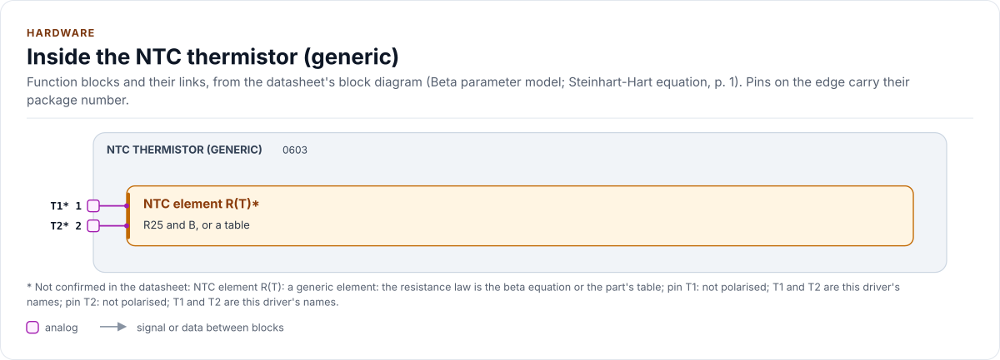
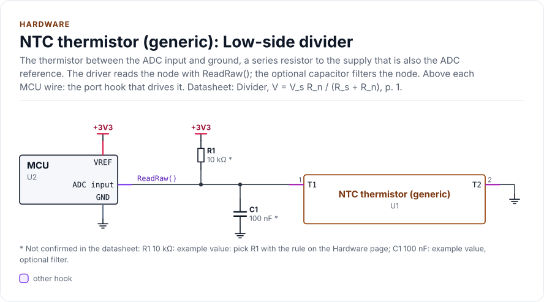
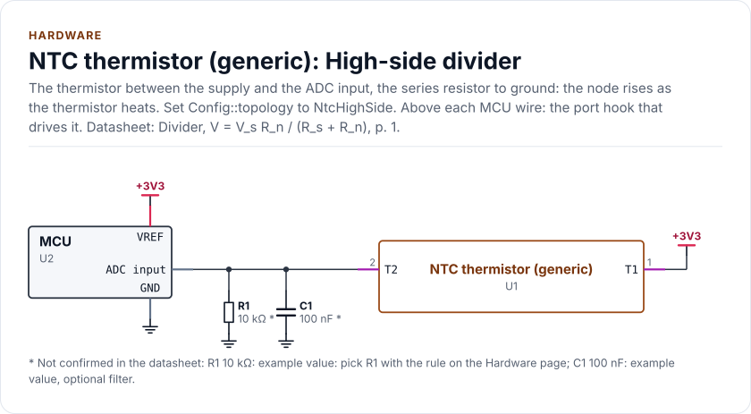
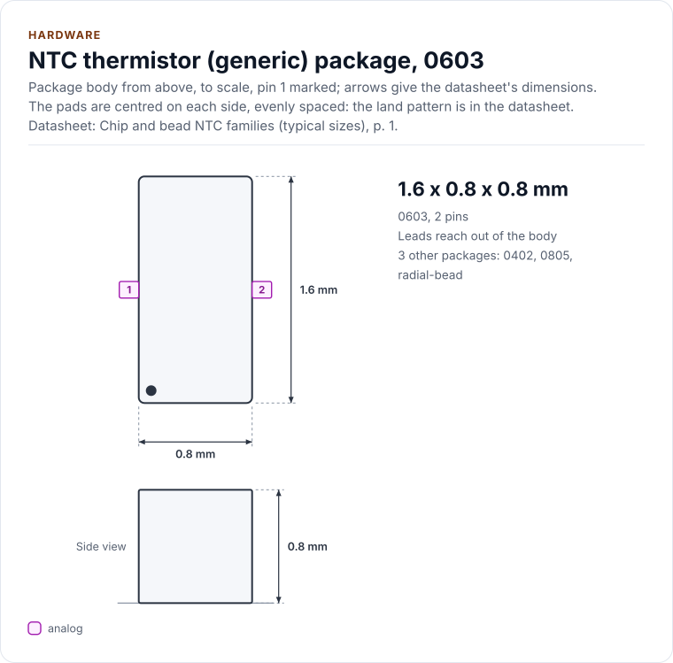
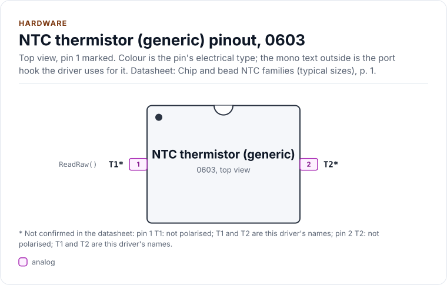
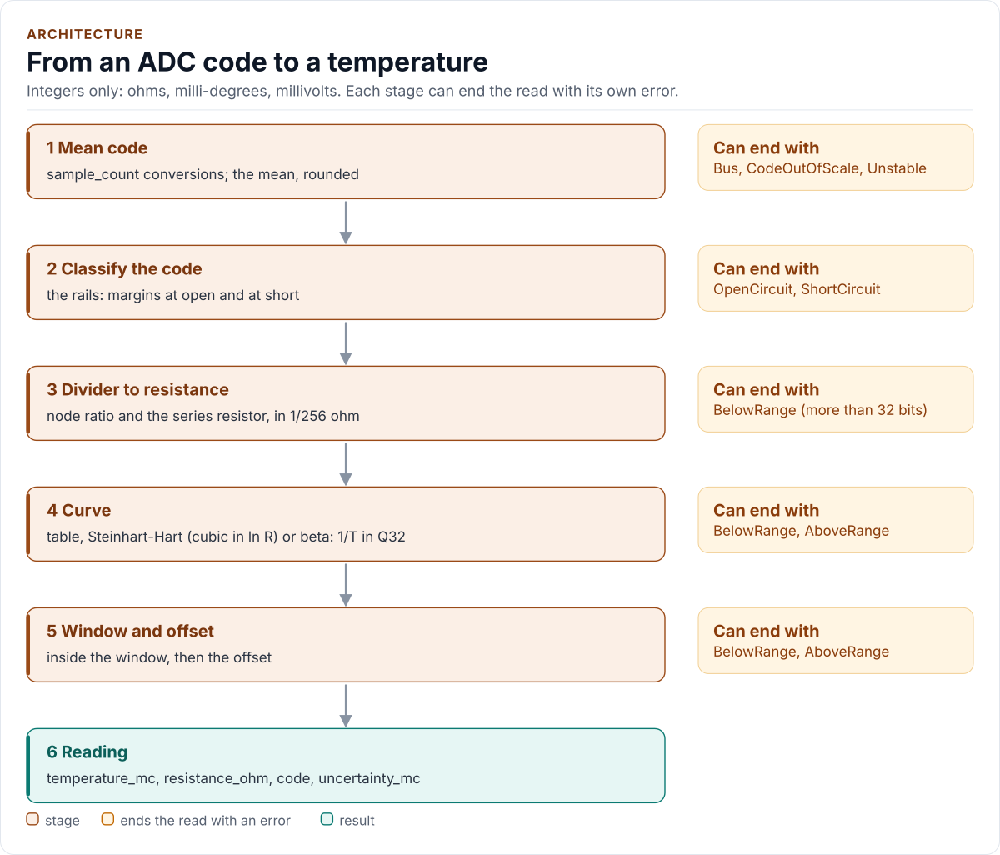
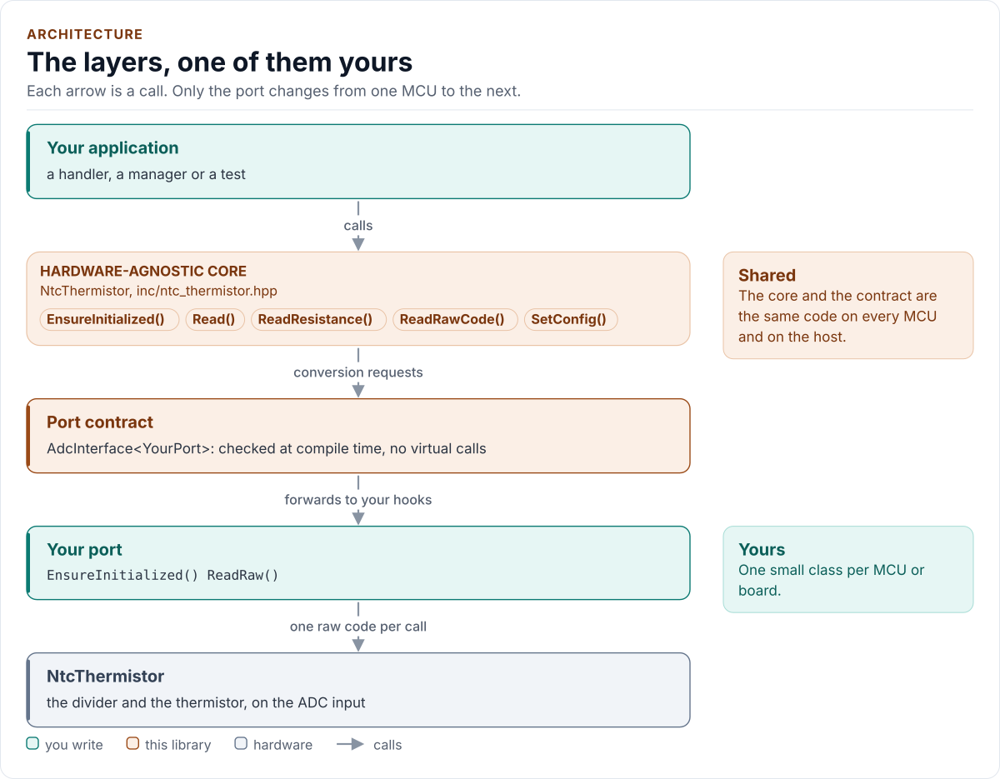

# Figures

<!-- Written by kokeb-docs figures from docs/diagrams/figures/*.py. Do not edit by hand. -->

Every figure on this site is drawn by a Python module from facts extracted from the code, so it is rebuilt,
not redrawn, when the code changes. CI runs `kokeb-docs figures --check` and fails when a
committed figure no longer matches the code. Each figure below lists the files it is drawn from.

## Inside the NTC thermistor (generic)

<!-- figure: chip-blocks -->
<picture>
  <source media="(prefers-color-scheme: dark)" srcset="chip-blocks.dark.svg">
  
</picture>
<!-- /figure -->

Hardware description: [`docs/hardware.yml`](../hardware.yml)

Drawn from:

- [`docs/hardware.yml`](../hardware.yml)
- [`inc/ntc_thermistor.hpp`](../../inc/ntc_thermistor.hpp)
- [`inc/ntc_thermistor_adc_interface.hpp`](../../inc/ntc_thermistor_adc_interface.hpp)

## NTC thermistor (generic): Low-side divider

<!-- figure: chip-circuit-divider -->
<picture>
  <source media="(prefers-color-scheme: dark)" srcset="chip-circuit-divider.dark.svg">
  
</picture>
<!-- /figure -->

Hardware description: [`docs/hardware.yml`](../hardware.yml)

Drawn from:

- [`docs/hardware.yml`](../hardware.yml)
- [`inc/ntc_thermistor.hpp`](../../inc/ntc_thermistor.hpp)
- [`inc/ntc_thermistor_adc_interface.hpp`](../../inc/ntc_thermistor_adc_interface.hpp)

## NTC thermistor (generic): High-side divider

<!-- figure: chip-circuit-divider-high -->
<picture>
  <source media="(prefers-color-scheme: dark)" srcset="chip-circuit-divider-high.dark.svg">
  
</picture>
<!-- /figure -->

Hardware description: [`docs/hardware.yml`](../hardware.yml)

Drawn from:

- [`docs/hardware.yml`](../hardware.yml)
- [`inc/ntc_thermistor.hpp`](../../inc/ntc_thermistor.hpp)
- [`inc/ntc_thermistor_adc_interface.hpp`](../../inc/ntc_thermistor_adc_interface.hpp)

## NTC thermistor (generic) package, 0603

<!-- figure: chip-outline -->
<picture>
  <source media="(prefers-color-scheme: dark)" srcset="chip-outline.dark.svg">
  
</picture>
<!-- /figure -->

Hardware description: [`docs/hardware.yml`](../hardware.yml)

Drawn from:

- [`docs/hardware.yml`](../hardware.yml)
- [`inc/ntc_thermistor.hpp`](../../inc/ntc_thermistor.hpp)
- [`inc/ntc_thermistor_adc_interface.hpp`](../../inc/ntc_thermistor_adc_interface.hpp)

## NTC thermistor (generic) pinout, 0603

<!-- figure: chip-pinout -->
<picture>
  <source media="(prefers-color-scheme: dark)" srcset="chip-pinout.dark.svg">
  
</picture>
<!-- /figure -->

Hardware description: [`docs/hardware.yml`](../hardware.yml)

Drawn from:

- [`docs/hardware.yml`](../hardware.yml)
- [`inc/ntc_thermistor.hpp`](../../inc/ntc_thermistor.hpp)
- [`inc/ntc_thermistor_adc_interface.hpp`](../../inc/ntc_thermistor_adc_interface.hpp)

## From an ADC code to a temperature

<!-- figure: conversion-pipeline -->
<picture>
  <source media="(prefers-color-scheme: dark)" srcset="conversion-pipeline.dark.svg">
  
</picture>
<!-- /figure -->

Figure module: [`docs/diagrams/figures/conversion-pipeline.py`](../../docs/diagrams/figures/conversion-pipeline.py)

Drawn from:

- `ConvertCode()` in [`inc/ntc_thermistor_conversion.hpp`](../../inc/ntc_thermistor_conversion.hpp)
- `FineOfCode()` in [`inc/ntc_thermistor_conversion.hpp`](../../inc/ntc_thermistor_conversion.hpp)
- `CurveTemperature()` in [`inc/ntc_thermistor_conversion.hpp`](../../inc/ntc_thermistor_conversion.hpp)

## The layers, one of them yours

<!-- figure: driver-layers -->
<picture>
  <source media="(prefers-color-scheme: dark)" srcset="driver-layers.dark.svg">
  
</picture>
<!-- /figure -->

Figure module: [`docs/diagrams/figures/driver-layers.py`](../../docs/diagrams/figures/driver-layers.py)

Drawn from:

- `public calls` in [`inc/ntc_thermistor.hpp`](../../inc/ntc_thermistor.hpp)
- `AdcInterface` in [`inc/ntc_thermistor_adc_interface.hpp`](../../inc/ntc_thermistor_adc_interface.hpp)
