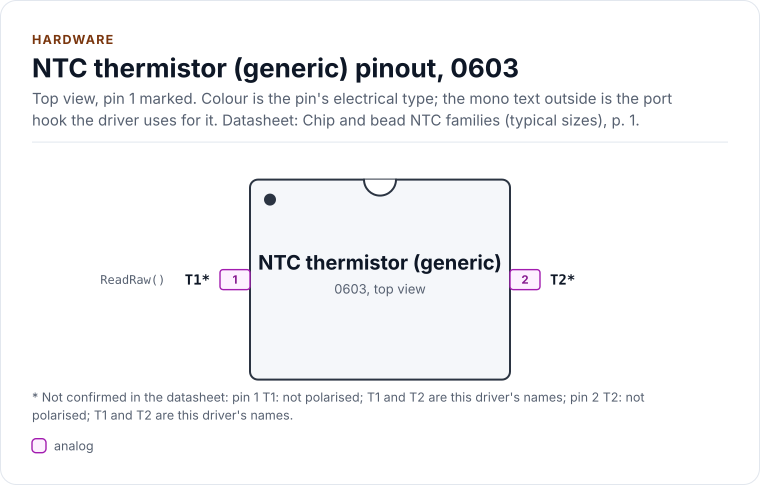
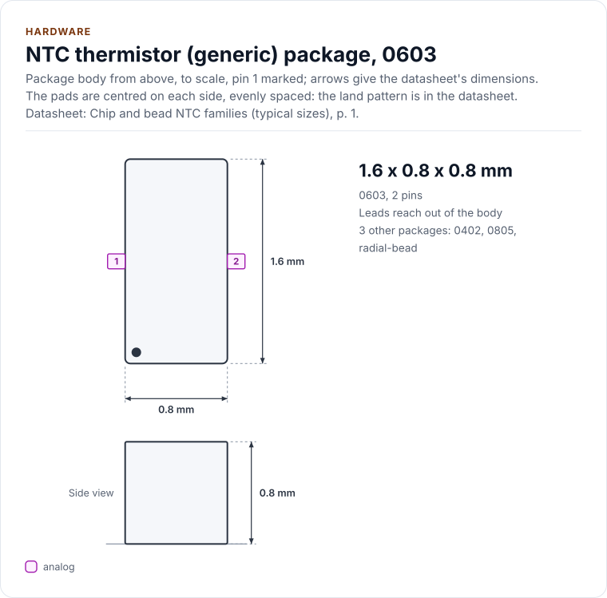
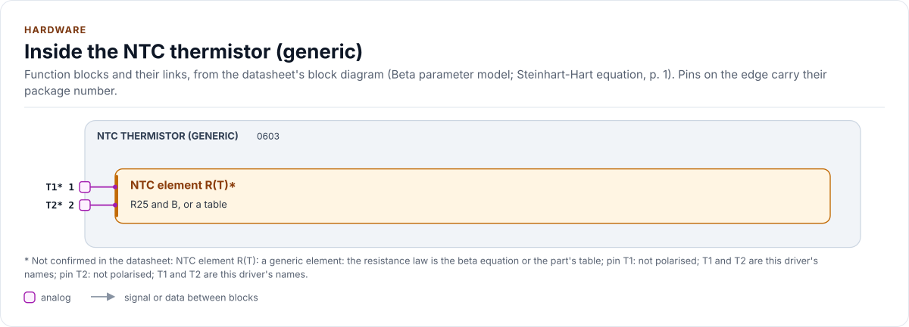
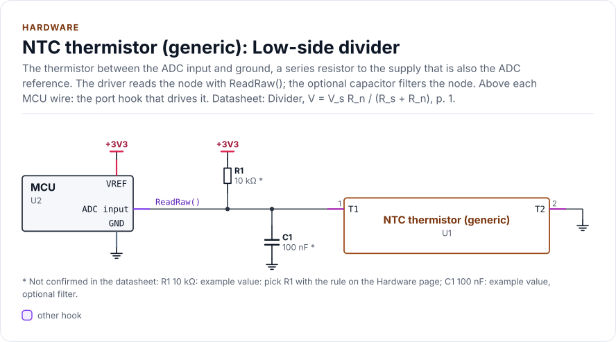
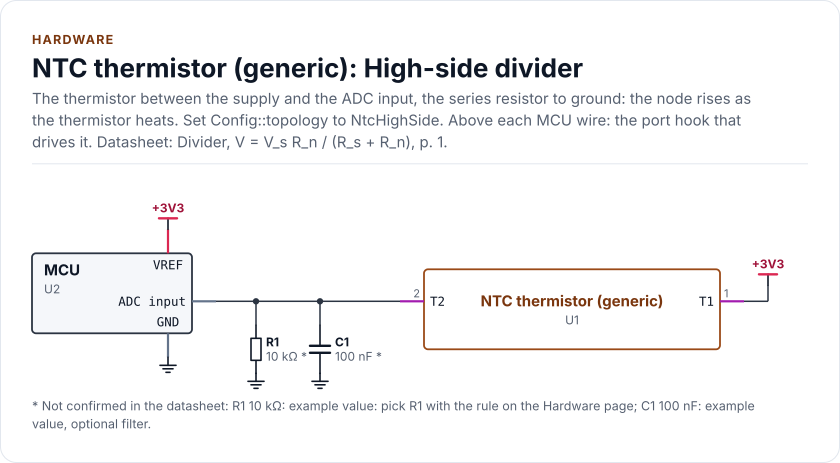

# Hardware

An NTC thermistor and its divider as the driver uses them: the two terminals, the package families, the divider, the
series resistor, the ADC input, self-heating and tolerances. Every number here is general or derived from the beta
equation; the figures for one part are labelled "worked example" and come from a preset whose table rows are
**unverified** (the vendor's sheet prints no table).

<!-- generated: datasheet-refs -->
??? abstract "Datasheet sections this page relies on"

    - Voltage divider and the series resistor: Public references n/a n/a, Divider, V = V_s R_n / (R_s + R_n), p. 1
    - Self-heating power: Public references n/a n/a, Dissipated power, P = V_s^2 R_n / (R_s + R_n)^2, p. 1
    - Example part: package and ratings: TDK none printed Rev.3, Dimension and Construction; Electrical Characteristics: power, dissipation, current, voltage, range, [p. 1](https://product.tdk.com/system/files/dam/doc/product/sensor/ntc/chip-ntc-thermistor/data_sheet/datasheet_ntcg163jf103ft1s.pdf#page=1)

    All of them, with the driver API for each: [Datasheet map](datasheet.md).
<!-- /generated -->

## The part

A thermistor has two terminals and no polarity. Its resistance falls as it heats: for most parts roughly 3 to 5 % per
kelvin near room temperature. The driver names the terminals T1 and T2 so the figures can draw them; neither the
part nor the driver cares which is which.

Families, as examples and **typical, not a datasheet claim** (the package drawn is the 0603 chip family; sizes are
family nominals, check your part):

| Family | Typical body | Seen as |
| --- | --- | --- |
| Chip 0402, 0603, 0805 | About 1.0 x 0.5, 1.6 x 0.8 and 2.0 x 1.25 mm | Two end terminals, reflow |
| Glass bead, epoxy-coated disc | Millimetres, on two leads | Probes, panel and liquid sensing |
| Ring lug, probe assembly | Part plus cable | Two wires |

Common classes: R25 of 2.2, 4.7, 10, 47 or 100 kOhm; B of about 3000 to 4300 K; 1 to 5 % on R25 and 1 to 3 % on B;
rated ranges of about -40 to +125 or +150 degrees Celsius, higher for glass. The pinout, the package outline, the block
diagram and the two circuits below are drawn from [`docs/hardware.yml`](hardware.yml).

<!-- figure: chip-pinout -->
<picture>
  <source media="(prefers-color-scheme: dark)" srcset="diagrams/chip-pinout.dark.svg">
  
</picture>
<!-- /figure -->

<!-- figure: chip-outline -->
<picture>
  <source media="(prefers-color-scheme: dark)" srcset="diagrams/chip-outline.dark.svg">
  
</picture>
<!-- /figure -->

<!-- generated: chip-pins -->
0603, 2 pins (Chip and bead NTC families (typical sizes), p. 1).

| Pin | Name | Type (domain) | Function | Driver hook | Datasheet |
| --- | --- | --- | --- | --- | --- |
| 1 | `T1` [^1] | analog (VDD) | One terminal, not polarised: see the two circuits for the wiring | `ReadRaw()` | Two-terminal resistor; terminals are not polarised, p. 1 |
| 2 | `T2` [^2] | analog (VDD) | The other terminal, not polarised: see the two circuits for the wiring | - | Two-terminal resistor; terminals are not polarised, p. 1 |

[^1]: Not confirmed in the datasheet: pin 1 (T1): not polarised; T1 and T2 are this driver's names.
[^2]: Not confirmed in the datasheet: pin 2 (T2): not polarised; T1 and T2 are this driver's names.

Source of this table and of the chip figures: [`docs/hardware.yml`](hardware.yml).
<!-- /generated -->

<!-- figure: chip-blocks -->
<picture>
  <source media="(prefers-color-scheme: dark)" srcset="diagrams/chip-blocks.dark.svg">
  
</picture>
<!-- /figure -->

## The divider

The driver reads the node of a resistor divider. In **low-side** form (the thermistor to ground) the node falls as
the part heats; in **high-side** form (the thermistor to the supply) it rises.

<!-- figure: chip-circuit-divider -->
<picture>
  <source media="(prefers-color-scheme: dark)" srcset="diagrams/chip-circuit-divider.dark.svg">
  
</picture>
<!-- /figure -->

<!-- figure: chip-circuit-divider-high -->
<picture>
  <source media="(prefers-color-scheme: dark)" srcset="diagrams/chip-circuit-divider-high.dark.svg">
  
</picture>
<!-- /figure -->

<!-- generated: chip-parts -->
**Low-side divider** (figure `chip-circuit-divider`)

| Part | Kind | Value | Connects | Datasheet |
| --- | --- | --- | --- | --- |
| U2 | MCU | - | VREF: +3V3, ADC_IN: NODE, GND: GND | Divider, V = V_s R_n / (R_s + R_n), p. 1 |
| R1 | resistor | 10 kΩ (not confirmed: example value: pick R1 with the rule on the Hardware page) | +3V3, NODE | Divider, V = V_s R_n / (R_s + R_n), p. 1 |
| C1 | capacitor | 100 nF (not confirmed: example value, optional filter) | NODE, GND | Divider, V = V_s R_n / (R_s + R_n), p. 1 |

**High-side divider** (figure `chip-circuit-divider-high`)

| Part | Kind | Value | Connects | Datasheet |
| --- | --- | --- | --- | --- |
| U2 | MCU | - | VREF: +3V3, ADC_IN: NODE, GND: GND | Divider, V = V_s R_n / (R_s + R_n), p. 1 |
| R1 | resistor | 10 kΩ (not confirmed: example value: pick R1 with the rule on the Hardware page) | NODE, GND | Divider, V = V_s R_n / (R_s + R_n), p. 1 |
| C1 | capacitor | 100 nF (not confirmed: example value, optional filter) | NODE, GND | Divider, V = V_s R_n / (R_s + R_n), p. 1 |

Export a circuit for a schematic or PCB tool: `kokeb-docs hardware --kicad-netlist OUT.net --circuit divider`.
<!-- /generated -->

With `Rs` the series resistor and `Rn` the thermistor, the node's share of the supply is `Rn / (Rs + Rn)` low side and
`Rs / (Rs + Rn)` high side. `Config::topology` says which. If the ADC's reference is the divider's supply, the code
is a pure ratio and the supply drops out (**ratiometric**, the default). If it is not, declare both
`adc_vref_mv` and `divider_supply_mv` (see [Configuration](configuration.md)); declaring one without the other is
`InvalidArgument`.

## Choosing the series resistor

The node moves most where `Rn` equals `Rs`, so put that at the middle of the range you care about. A good rule for a
whole range is the geometric mean:

```text
Rs = sqrt(R(Tmin) * R(Tmax))
```

Worked example (rows unverified): 188.5 kOhm at -40 and 313 Ohm at +150 give 7.7 kOhm; 10 kOhm centres the divider at
25 degrees Celsius instead and is the common choice. Round to the nearest value you can buy and give the driver the
real value in `series_ohm` (1 to 16 777 216 ohms), with its tolerance in `series_tol_ppm` so the bound includes it.

## What an ADC step is worth

Near a divider's middle one ADC step is about `T^2 / B / (r (1 - r)) / 2^bits` kelvin, with `r` the node's share. It
is finest where `r` is 0.5 and coarsens toward the ends. Worked example, a 12-bit ADC, 10 kOhm series resistor and the
example preset (derived from its rows, which are unverified):

| Temperature (degC) | Resistance (ohm) | Code | One code is (K) |
| --- | --- | --- | --- |
| -35 | 144 300 | 3831 | 0.076 |
| 0 | 27 280 | 2997 | 0.028 |
| 25 | 10 000 | 2048 | 0.026 |
| 60 | 3 019 | 950 | 0.044 |
| 85 | 1 451 | 519 | 0.079 |
| 125 | 534 | 208 | 0.220 |
| 145 | 346 | 137 | 0.353 |

A 16-bit ADC divides these by 16. The driver carries resistance to 1/256 ohm inside, so its own rounding stays well
below one code even at the hot end.

## The ADC input

- **Source impedance.** The divider's output impedance is `Rs` in parallel with `Rn`, up to `Rs`. Read your ADC's
  recommended source impedance; a high one needs a capacitor at the node, and averaging (`sample_count`) helps.
- **Filter and settling.** 100 nF from the node to ground is a common start (a time constant of about 1 ms at 10 kOhm);
  the thermistor is slow, so a slow filter costs nothing but start-up time. The node settles with the time constant
  `(Rs || Rn) x C`, where `Rn` is the part's resistance at the cold end, so set `settle_us` to at least five of them
  (5 ms for 10 kOhm and 100 nF), and check that the ADC's sampling capacitor charges through the source impedance
  within its sampling time. A bias switch is needed for `settle_us` to mean anything: without one it is not allowed.
- **A cut wire.** A broken wire between the node and the ADC pin leaves the input floating, and the driver cannot tell
  it from a temperature: a pull resistor at the pin, or a reading with the divider off, is yours.
- **Range.** The node must stay inside the ADC's input range; with separate supply and reference, choose `Rs` so the
  node share times the supply stays below the reference.
- **Margins.** A node within `open_margin_codes` of the open rail reads `OpenCircuit`, within `short_margin_codes` of
  the short rail `ShortCircuit` (2 codes by default, 1 or more with separate supply and reference). The margins are in
  codes: size them to the noise of the node, a few codes at 12 bits, hundreds at 20 bits and wider.

## Self-heating

The divider heats the thermistor: `P = Vs^2 * Rn / (Rs + Rn)^2`, at most `Vs^2 / (4 Rs)`. The rise is `P` divided by
the part's dissipation constant in your mounting, in milliwatts per kelvin; about 1 mW/K is typical for a chip part on
a board (the worked example's sheet gives 1 mW/degC at 25 degrees Celsius), but yours comes from its datasheet and
your assembly. At 3.3 V with 10 kOhm and 10 kOhm that is 272 uW, about 0.27 K at 1 mW/K, which is ten ADC steps of the
worked example. `SelfHeatingMicrowatts()` computes `P`; the driver does not correct for it. To cut it, power the
divider from a GPIO only while sampling (`SetBias()`, see [Porting](porting.md)), raise `Rs`, or lower the supply.

```cpp title="reference.cpp"
--8<-- "tests/docs/reference.cpp:self-heating"
```

## Tolerance

At temperature `T` (kelvin) a relative error `dR/R` in the resistance is a temperature error of
`(T^2 / B) * (dR/R)`; at 25 degrees Celsius with B 3435 K, 1 % is 0.26 K. A B error matters away from the 25 degree
point: it is multiplied by `ln(R/R0)`. `Reading::uncertainty_mc` adds these terms, the series resistor's tolerance
and one converter step.

## Faults the divider cannot tell apart

A cut wire or missing part drives a low-side node to the supply rail: `OpenCircuit`. A shorted part drives it to ground:
`ShortCircuit`. **A divider whose supply has collapsed also reads as a short** on a low-side divider (the node is at
ground), and the driver has no second channel to tell them apart. If that matters, measure the supply on another
channel in your application.

## Adapting `hardware.yml` and the card to your part

`docs/hardware.yml` describes a generic two-terminal part. To describe yours:

1. `chip`: the part's name.
2. `package`: its `type`, the `outline` from the part's drawing and the `variants` from its ordering table.
3. The `ntc` block's `detail`: R25 and B, or "table".
4. The circuits: `R1`, `C1` and the supply of your divider.
5. Point each `refs` entry at your datasheet (document `ds` in [`docs/datasheets.yml`](datasheets.yml): the section and
   the printed page) and delete each `unverified` you have confirmed.

Keep the pins `T1` and `T2` and the two hooks. Then run `kokeb-docs hardware --check`, `kokeb-docs figures` and
`kokeb-docs gen`: the pinout, the outline, the block diagram, the circuits and the README's chip card follow.
