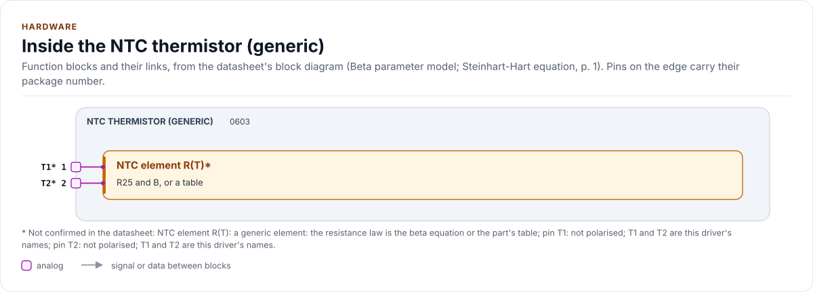
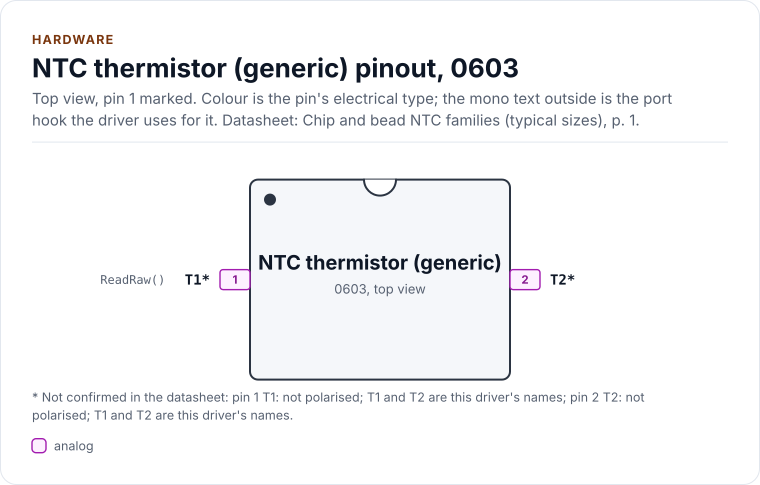
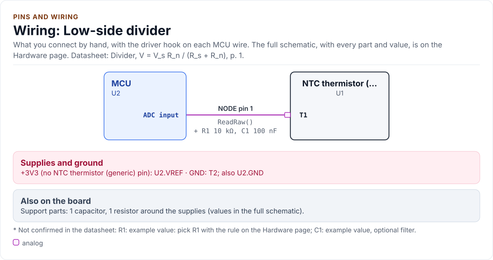
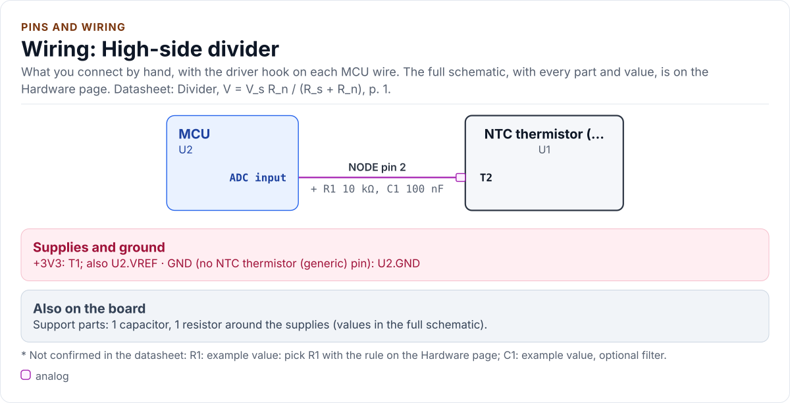
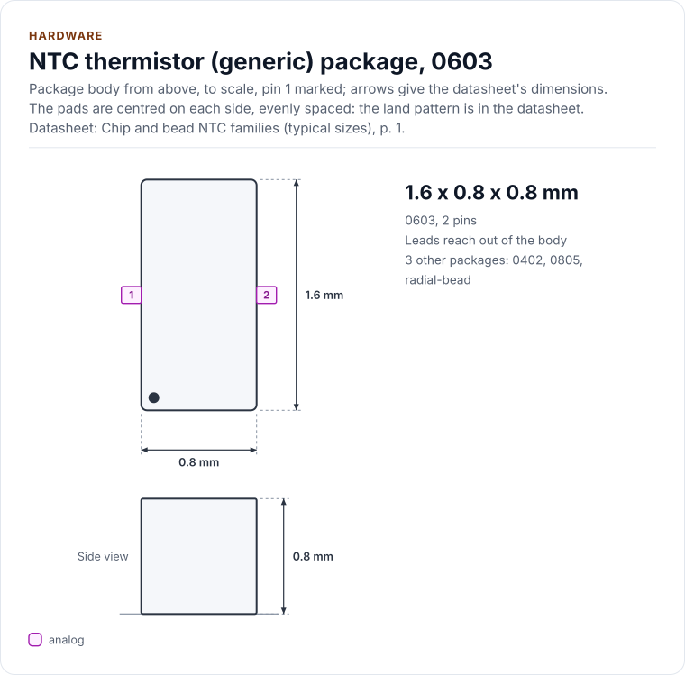

---
hide:
  - navigation
  - toc
---

<div class="kb-hero" markdown>
<span class="kb-kicker">Driver</span>

# NTC thermistor driver

<p>A C++20 driver for any NTC thermistor read through a resistor divider into an ADC input: it turns a raw code into
milli-degrees Celsius with integers only.</p>

[Quickstart](quickstart.md){ .md-button .md-button--primary }
[API guide](api-guide.md){ .md-button }
[Source on GitHub](https://github.com/kokeb-labs-drivers/driver-ntc-thermistor){ .md-button }
</div>

<!-- generated: chip-summary -->
The **NTC thermistor (generic)** is a resistor whose resistance falls as it heats: with a series resistor it makes a
voltage divider an ADC can read, and a curve (a table, Steinhart-Hart coefficients, or R25 and B) turns the resistance
into a temperature (Beta parameter model; Steinhart-Hart equation, p. 1).
<!-- /generated -->

<!-- figure: chip-hero -->
<picture>
  <source media="(prefers-color-scheme: dark)" srcset="diagrams/chip-hero.dark.svg">
  
</picture>
<!-- /figure -->

## What it does

<!-- figure: chip-capabilities -->
<picture>
  <source media="(prefers-color-scheme: dark)" srcset="diagrams/chip-capabilities.dark.svg">
  
</picture>
<!-- /figure -->

## Where it is used

<!-- generated: chip-uses -->
- Temperature protection: what the datasheet of the example part calls it

Uses named by the datasheet (Title, [p.
1](https://product.tdk.com/system/files/dam/doc/product/sensor/ntc/chip-ntc-thermistor/data_sheet/datasheet_ntcg163jf103ft1s.pdf#page=1)).
<!-- /generated -->

## Inside the part

<!-- figure: chip-blocks -->
<picture>
  <source media="(prefers-color-scheme: dark)" srcset="diagrams/chip-blocks.dark.svg">
  
</picture>
<!-- /figure -->

## Pins and wiring

<!-- figure: chip-pinout -->
<picture>
  <source media="(prefers-color-scheme: dark)" srcset="diagrams/chip-pinout.dark.svg">
  
</picture>
<!-- /figure -->

<!-- figure: chip-wiring-divider -->
<picture>
  <source media="(prefers-color-scheme: dark)" srcset="diagrams/chip-wiring-divider.dark.svg">
  
</picture>
<!-- /figure -->

<!-- figure: chip-wiring-divider-high -->
<picture>
  <source media="(prefers-color-scheme: dark)" srcset="diagrams/chip-wiring-divider-high.dark.svg">
  
</picture>
<!-- /figure -->

<!-- figure: chip-outline -->
<picture>
  <source media="(prefers-color-scheme: dark)" srcset="diagrams/chip-outline.dark.svg">
  
</picture>
<!-- /figure -->

The pin tables, the full schematic and the timing are on [Hardware](hardware.md).

## Quick start

Wire the part as above, write the port for your MCU ([Porting](porting.md)), then:

<!-- generated: quickstart-code -->
```cpp
#include "ntc_thermistor.hpp"
#include "ntc_thermistor_presets.hpp"

// A 10 kOhm / B 3950 thermistor low-side in a 10 kOhm divider on a 12-bit ADC,
// valid from -40 to +125 degC.
constexpr ntc_thermistor::Config kConfig{.curve = ntc_thermistor::presets::kGeneric10kB3950,
                                         .min_temperature_mc = -40'000,
                                         .max_temperature_mc = 125'000};

int read_temperature_mc(MyPort& port, int32_t& milli_celsius) {
  ntc_thermistor::NtcThermistor<MyPort> sensor(port, kConfig); // no I/O yet

  if (auto r = sensor.EnsureInitialized(); !r) { // 1. check the config, bring the ADC up
    return static_cast<int>(r.error);            //    InvalidArgument or Bus
  }
  const auto t = sensor.Read(); // 2. sample, divider to ohms, curve to temperature
  if (!t) {
    return static_cast<int>(t.error); //    OpenCircuit, ShortCircuit, BelowRange, ...
  }
  milli_celsius = t.value.temperature_mc; // 3. milli-degrees Celsius;
                                          // t.value.uncertainty_mc bounds it
  return 0;
}
```
<!-- /generated -->

Every step, with the port and what to check when it does not work: [Quickstart](quickstart.md).

## Driver coverage

<!-- generated: chip-coverage -->
| Capability | What the chip does | Driver API | Registers | Status | Datasheet |
| --- | --- | --- | --- | --- | --- |
| [Voltage divider](conversion.md) | Turns the voltage at the divider node into the thermistor's resistance, thermistor low side or high side | `ReadResistance`, `Convert`, `Topology::NtcLowSide`, `Topology::NtcHighSide` | - | Supported | Divider, V = V_s R_n / (R_s + R_n), p. 1 |
| [Beta equation](conversion.md) | Temperature from R25 and B (B25/85 by default), in fixed point, inside the rated window you declare | `r0_ohm`, `b_kelvin`, `b_t2_mc` | - | Supported | Beta parameter model; Steinhart-Hart equation, p. 1 |
| [Steinhart-Hart](conversion.md) | Temperature from the three Steinhart-Hart coefficients, in integers | `sh_a_e15`, `sh_b_e15`, `sh_c_e15` | - | Supported | Beta parameter model; Steinhart-Hart equation, p. 1 |
| [Resistance table](presets.md) | Temperature from a table of resistance and temperature rows, interpolated in ln R; any part is data | `TablePoint`, `table`, `presets::kTdkNtcg163jf103ft1s` | - | Supported | Beta parameter model; Steinhart-Hart equation, p. 1 |
| Open, short and range faults | Names a cut wire, a short, a part outside its window, noisy samples and an ADC that disagrees | `Error::OpenCircuit`, `Error::ShortCircuit`, `Error::BelowRange`, `Error::AboveRange`, `Error::Unstable`, `Error::CodeOutOfScale` | - | Supported | Divider, V = V_s R_n / (R_s + R_n), p. 1 |
| Reading uncertainty | Bounds every reading from the tolerances you declare and one converter step | `uncertainty_mc`, `r_tol_ppm`, `b_tol_ppm`, `series_tol_ppm` | - | Supported | Beta parameter model; Steinhart-Hart equation, p. 1 |
| Self-heating | Estimates the power the divider dissipates in the thermistor, to size the series resistor | `SelfHeatingMicrowatts` | - | Supported | Dissipated power, P = V_s^2 R_n / (R_s + R_n)^2, p. 1 |
| [Switched bias](hardware.md) | Switches the divider supply from an MCU pin and waits for it to settle, to cut current and self-heating | `SetBias`, `settle_us` | - | Supported | Divider, V = V_s R_n / (R_s + R_n), p. 1 |

**Supported**: the driver covers it and a host test checks it.

From [`docs/hardware.yml`](hardware.yml); `kokeb-docs hardware --check` confirms that every API name is in
`inc/ntc_thermistor.hpp`, `inc/ntc_thermistor_types.hpp`, `inc/ntc_thermistor_conversion.hpp`,
`inc/ntc_thermistor_presets.hpp`, `inc/ntc_thermistor_adc_interface.hpp`.
<!-- /generated -->

The driver knows no part. A thermistor is **data**: a table of resistance and temperature rows, Steinhart-Hart
coefficients, or R25 and B for the beta equation, given in a `Curve`. The driver reads the divider node through a small
port class you write, finds the thermistor's resistance, and looks the temperature up on the curve. Open and short
circuits, a node outside the
ADC's range and a part outside its rated window are errors with their own names, and every reading carries a bound.

## What you get

- **Any NTC, no change of code.** A part is a `Curve`; the driver ships two presets and the way to write your own.
  See [Presets](presets.md) and [Configuration](configuration.md).
- **Three ways to describe a part**: a table of any 2 to 256 rows and any spacing, interpolated linearly in ln R,
  Steinhart-Hart coefficients, or R25 and B. `tools/ntc_table.py` makes a table from any of them or from a vendor's
  list. See [Conversion](conversion.md).
- **Faults by name**: `OpenCircuit`, `ShortCircuit`, `BelowRange`, `AboveRange`, `Unstable`, `CodeOutOfScale`.
  See [Troubleshooting](troubleshooting.md).
- **A bound on every reading** from the tolerances you declare and one converter step.
- **Tested without hardware** against a model that shares no code with the driver. See [Testing and CI](testing.md).

    !!! warning "Not verified on hardware" The driver is host-tested against a model of the divider and fuzzed; it has
    not been run on a thermistor. The example preset (a TDK part) takes R25, B and the tolerances from the vendor's
    Rev.3 datasheet; its 39 table rows are a secondary listing, **unverified** because that sheet prints no table.
    Nothing generic depends on it. See [Status and limitations](limitations.md).

## Datasheet

<!-- generated: datasheet-card -->
| Document | Revision | Get it |
| --- | --- | --- |
| Reference: Beta equation, Steinhart-Hart equation and the voltage divider (Public references n/a) | n/a, n/a | [vendor page](https://en.wikipedia.org/wiki/Steinhart%E2%80%93Hart_equation) |
| Datasheet: Chip NTC Thermistor, NTCG series, NTCG163JF103FT1S (datasheet) (TDK none printed) | Rev.3, May 8, 2023 | [PDF](https://product.tdk.com/system/files/dam/doc/product/sensor/ntc/chip-ntc-thermistor/data_sheet/datasheet_ntcg163jf103ft1s.pdf) · [vendor page](https://product.tdk.com/system/files/dam/doc/product/sensor/ntc/chip-ntc-thermistor/data_sheet/datasheet_ntcg163jf103ft1s.pdf) |

Written against these revisions; the SHA-256 of each file is in [`docs/datasheets.yml`](datasheets.yml). Where each part
of the driver is in the datasheet: [Datasheet map](datasheet.md).
<!-- /generated -->
